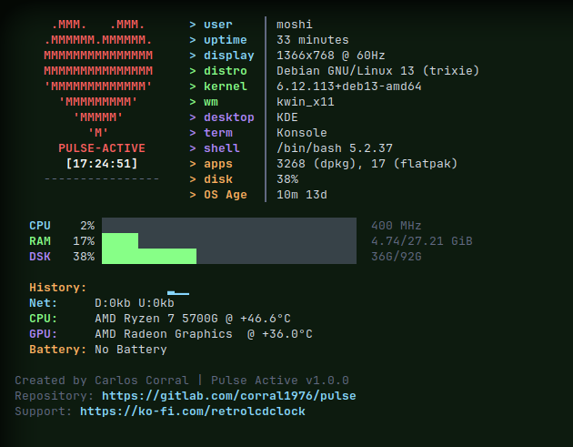

# Pulse-Active v1.0.0

[](https://opensource.org/licenses/MIT)
[](https://github.com/corral1976/pulse/releases)
[](https://github.com/corral1976/pulse/actions)



A minimalist and elegant system monitor for the terminal, designed for advanced GNU/Linux users. It offers real-time visualization of CPU (including frequency and history graphs), RAM, disk, network, and temperatures, featuring a design optimized for terminals with modern fonts.

## Features

- **Dual-mode display**: GUI with colors and TTY with ASCII
- **Real-time monitoring**: CPU, RAM, disk, network, and temperature metrics
- **Intelligent caching**: Performance optimization for sensor data
- **Quiet mode**: Single-line output for scripting and dashboards
- **Desktop integration**: System launcher and icon
- **Hardware support**: lm-sensors, NVIDIA/AMD GPU, battery monitoring

## Installation

Pulse is a single Bash script, so it runs on **any Linux distribution**. Which method to use depends on your distro:

| Your distribution | Recommended method |
|---|---|
| Debian, Ubuntu, **Linux Mint**, Pop!_OS, Zorin OS, elementary OS, MX Linux and other Debian/Ubuntu-based distros | [Method A: .deb package](#method-a-deb-package-debian-ubuntu-linux-mint-and-derivatives) |
| **Fedora**, RHEL/CentOS/Rocky/Alma, openSUSE, **Arch/Manjaro**, and any other distro | [Method B: manual install](#method-b-manual-install-any-linux-distribution) |

> **New to Linux?** If you don't know which one to pick: Linux Mint, Ubuntu and Debian users use Method A. Everyone else uses Method B. The `.deb` format only exists on Debian-family systems, so you do **not** need to build or install a `.deb` on Fedora, Arch, etc.

### Method A: .deb package (Debian, Ubuntu, Linux Mint and derivatives)

1. Download `pulse-active_1.0.0_all.deb` from the [Releases page](https://gitlab.com/corral1976/pulse/-/releases).
2. Install it from the folder where you downloaded it:

```bash
sudo apt install ./pulse-active_1.0.0_all.deb
```

(`sudo dpkg -i pulse-active_1.0.0_all.deb` also works.) This installs the `pulse` command, the desktop launcher and the icon.

**Building the .deb yourself (optional):**

```bash
git clone https://gitlab.com/corral1976/pulse.git
cd pulse
bash BUILD_DEB.sh
sudo apt install ./pulse-active_1.0.0_all.deb
```

### Method B: manual install (any Linux distribution)

No package is needed: just put the script in a folder that is in your `PATH` and make it executable. `/usr/local/bin` is the standard place for this and works the same on every distribution.

```bash
git clone https://gitlab.com/corral1976/pulse.git
cd pulse
sudo install -Dm755 debian/usr/bin/pulse /usr/local/bin/pulse
```

(Run it from inside the `pulse` folder you just cloned. `-D` creates the destination folder if your system doesn't have it yet.) That's it: open a terminal and run `pulse`.

> If you get `sudo: command not found` or you are already logged in as root, run the same command without `sudo`.

**No admin rights, or just want to try it first?** You don't need to install anything, run it straight from the downloaded folder:

```bash
cd pulse/debian/usr/bin
chmod +x pulse
./pulse
```

**Want it as a command for your user only (no `sudo`)?** Run this from inside the `pulse` folder. The folder `~/.local/bin` is not guaranteed to exist or to be in your `PATH` on every distro, so create it and check:

```bash
mkdir -p ~/.local/bin
install -m 755 debian/usr/bin/pulse ~/.local/bin/pulse
echo "$PATH" | grep -q "$HOME/.local/bin" || echo 'export PATH="$HOME/.local/bin:$PATH"' >> ~/.bashrc
```

Then close and reopen the terminal.

### Check that it works

```bash
pulse --version
```

Then install the [optional dependencies](#optional-dependencies-installation) for your distro if you want temperatures, GPU info, battery and screen resolution (Pulse runs without them, it just shows less information).

## Usage

```bash
pulse              # Start monitoring
pulse --quiet      # Single-line mode
pulse -i 2         # Refresh every 2 seconds
pulse --help       # Show help
pulse --version    # Show version
```

Press any key to exit.

## Options

- `-h, --help` - Show help message
- `-v, --version` - Show version information
- `-i, --interval N` - Refresh interval in seconds (default: 1)
- `-q, --quiet` - Single-line minimal output
- `-n, --no-color` - Disable colored output

## Environment Variables

```bash
DISK_PATH=/home pulse    # Monitor /home instead of /
WM=i3 pulse              # Override window manager detection
```

## Requirements

- **Required**: Bash 4.0+, Linux system with /proc
- **Recommended** for enhanced functionality:
  - `lm-sensors` (CPU/GPU temperature)
  - NVIDIA driver with `nvidia-smi` (NVIDIA GPU temperature)
  - `mesa-utils` / `glx-utils` (GPU information)
  - `pciutils` (GPU fallback)
  - `upower` (battery monitoring)
  - `xdpyinfo` (screen resolution)
  - `procps` (system utilities)

Package names differ between distributions, see the next section.

## Optional Dependencies Installation

### Debian/Ubuntu/Linux Mint
```bash
sudo apt install lm-sensors mesa-utils pciutils upower x11-utils procps
sudo sensors-detect
```

### Fedora/RHEL/CentOS
```bash
sudo dnf install lm_sensors glx-utils pciutils upower xdpyinfo procps-ng
sudo sensors-detect
```

### Arch Linux/Manjaro
```bash
sudo pacman -S lm_sensors mesa-utils pciutils upower xorg-xdpyinfo procps-ng
sudo sensors-detect
```

### Other distributions
Install the equivalents of the packages listed under [Requirements](#requirements) with your package manager.

`sensors-detect` is only needed for temperature readings: answer the questions (the defaults are fine) and, if asked, let it load the suggested modules.

## Troubleshooting

**`Error: faltan comandos esenciales: hostname`** (or another basic command) on a minimal install: install the package that provides it, e.g. `sudo dnf install hostname` on Fedora or `sudo pacman -S inetutils` on Arch.

**Temperatures show `N/A`**: install `lm-sensors` and run `sudo sensors-detect` (see above).

## Removal

**Method A (.deb):**
```bash
sudo apt remove pulse-active
```

**Method B (manual):**
```bash
sudo rm /usr/local/bin/pulse          # or, if installed for your user only: rm ~/.local/bin/pulse
```

## License

MIT License - See LICENSE file for details.

## Support

- **Repository**: https://gitlab.com/corral1976/pulse
- **Issues**: https://gitlab.com/corral1976/pulse/-/issues
- **Support**: https://ko-fi.com/retrolcdclock

## Author

Carlos Corral - Pulse Active
